# 🎬 Codeflix Catalog Admin — Microsserviço de Catálogo de Vídeos (.NET)


API RESTful de administração do catálogo de vídeos da plataforma **Codeflix**, desenvolvida em **C# / .NET 10** aplicando **Clean Architecture**, **Domain-Driven Design (DDD)** e **Test-Driven Development (TDD)** com pirâmide completa de testes (Unitários, Integração e End-to-End).

---

## 🏛️ Visão Geral e Arquitetura

O projeto foi desenhado para isolar completamente as regras de negócio de detalhes de infraestrutura, frameworks web, mensageria e banco de dados, seguindo os princípios da **Clean Architecture** combinados aos blocos táticos do **DDD**:

```mermaid
flowchart TD
    subgraph API ["Camada de Apresentação (FC.Codeflix.Catalog.Api)"]
        Controllers["REST Controllers\n(Categories, Genres, CastMember, Videos)"]
        Filters["Global Exception Filter\n(RFC 7807 ProblemDetails)"]
    end

    subgraph APP ["Camada de Aplicação (FC.Codeflix.Catalog.Application)"]
        UseCases["Use Cases (MediatR Handlers)\nCategory | Genre | CastMember | Video"]
        EventPub["DomainEventPublisher & EventHandlers\n(SendToEncoderEventHandler)"]
        Boundaries["Input / Output DTOs & Interfaces\n(IUnitOfWork, IStorageService, IMessageProducer)"]
    end

    subgraph DOMAIN ["Núcleo de Domínio (FC.Codeflix.Catalog.Domain)"]
        Aggregates["Aggregate Roots & Entities\n(Category, Genre, CastMember, Video, Media)"]
        ValueObjects["Value Objects & Enums\n(Image, ERating, EMediaStatus, ECastMemberType)"]
        SeedWork["SeedWork\n(Entity, AggregateRoot, DomainEvent, Repositories)"]
        Validation["Domain Validation, Notification Pattern & Exceptions"]
    end

    subgraph INFRA_EF ["Infraestrutura de Dados (FC.Codeflix.Catalog.Infra.Data.EF)"]
        DbContext["CodeflixCatalogDbContext (EF Core)"]
        Repos["Repositories & UnitOfWork\n(Category, Genre, CastMember, Video)"]
        JoinModels["Persistence Models & Configurations\n(GenresCategories, VideosCategories, VideosGenres, VideosCastMembers)"]
    end

    subgraph INFRA_STORAGE ["Infraestrutura de Storage (FC.Codeflix.Catalog.Infra.Storage)"]
        GCS["StorageService\n(Google Cloud Storage)"]
    end

    subgraph INFRA_MSG ["Infraestrutura de Mensageria (FC.Codeflix.Catalog.Infra.Messaging)"]
        RMQ["RabbitMQProducer & ChannelManager\n(RabbitMQ / EventsMapping)"]
    end

    Controllers --> UseCases
    UseCases --> Aggregates
    UseCases --> SeedWork
    UseCases --> Boundaries
    EventPub --> SeedWork
    EventPub --> Boundaries
    Repos -.->|Implementa| SeedWork
    Repos --> DbContext
    DbContext --> JoinModels
    GCS -.->|Implementa| Boundaries
    RMQ -.->|Implementa| Boundaries
    API --> INFRA_EF
    API --> INFRA_STORAGE
    API --> INFRA_MSG
```



### Principais Decisões Arquiteturais

- **Entidades Ricas, Value Objects e Invariantes de Domínio (`Domain`)**:
  - Os agregados (`Category`, `Genre`, `CastMember`, `Video`) protegem seu próprio estado interno através de construtores/fábricas, encapsulamento de coleções (`IReadOnlyList<Guid>`) e métodos de comportamento (`Update`, `Activate`, `Deactivate`, `AddCategory`, `UpdateMedia`, `UpdateTrailer`, `UpdateAsSendToEncode`, `UpdateAsEncoded`, etc.).
  - Uso de **Value Objects** (como `Image` para `Thumb`, `ThumbHalf` e `Banner`) e **Entidades Internas** (`Media` para `Trailer` e `Media` principal do vídeo com controle de ciclo de vida via `EMediaStatus`).
  - Validações de domínio combinam validações imediatas e o **Notification Pattern** (`Notification`, `VideoValidator`), garantindo que nenhuma entidade persista em estado inválido (`EntityValidationException`).
- **Eventos de Domínio (`Domain Events`) e Mensageria Assíncrona (`Infra.Messaging`)**:
  - `AggregateRoot` mantém uma coleção de eventos de domínio (`Events`, `RaiseEvent`). Ao registrar um arquivo de vídeo em `Video.UpdateMedia`, o agregado dispara `VideoUploadedEvent`.
  - Durante o `UnitOfWork.Commit`, o `DomainEventPublisher` publica os eventos antes de persistir a transação para os handlers registrados (`IDomainEventHandler<T>`), como o `SendToEncoderEventHandler`, que envia a mensagem ao RabbitMQ por meio do contrato `IMessageProducer` (`RabbitMQProducer`).
- **Limites de Agregado e Relacionamentos Desacoplados**:
  - Seguindo boas práticas de DDD, agregados como `Genre` e `Video` referenciam outros agregados (`Category`, `Genre`, `CastMember`) apenas por identidade (`Guid`), evitando grafos de objetos acoplados em memória.
  - Na camada de infraestrutura (`Infra.Data.EF`), modelos de junção (`GenresCategories`, `VideosCategories`, `VideosGenres`, `VideosCastMembers`) mapeiam as relações N:N no banco relacional sem poluir o domínio com propriedades de navegação do Entity Framework.
- **Casos de Uso Orientados a Comandos/Queries (`Application`)**:
  - Cada operação de negócio (`CreateCategory`, `UpdateGenre`, `ListCastMember`, `CreateVideo`, `UploadMedias`, etc.) é isolada em seu próprio caso de uso orquestrado via **MediatR**, respeitando o *Single Responsibility Principle (SRP)*.
- **Padrão Repository, Unit of Work & Cloud Storage (`Infra.Data.EF` & `Infra.Storage`)**:
  - Os contratos de repositório (`ICategoryRepository`, `IGenreRepository`, `ICastMemberRepository`, `IVideoRepository`) residem no Domínio, enquanto a implementação com **EF Core** fica restrita à Infraestrutura.
  - O `UnitOfWork` coordena a publicação de eventos de domínio e a atomicidade transacional (`Commit` / `Rollback`).
  - O projeto `FC.Codeflix.Catalog.Infra.Storage` implementa `IStorageService` integrando com o **Google Cloud Storage** para upload e exclusão de mídias e imagens de vídeos.
- **Padronização de Contratos HTTP e Tratamento Global de Erros (`Api`)**:
  - Serialização padronizada em `snake_case` (`JsonSerializerConfiguration`) e envelopes de resposta consistentes (`ApiResponse<T>` e `ApiResponseList<T>` com metadados de paginação).
  - Filtro global (`ApiGlobalExceptionFilter`) traduzindo exceções de domínio e aplicação (`EntityValidationException` $\rightarrow$ `422 Unprocessable Entity`, `RelatedAggregateException` $\rightarrow$ `422 Unprocessable Entity`, `NotFoundException` $\rightarrow$ `404 Not Found`) para o padrão **RFC 7807 (`ProblemDetails`)**.

---

## 🛠️ Tecnologias, Bibliotecas e Padrões

| Categoria | Tecnologia / Biblioteca | Finalidade |
| :--- | :--- | :--- |
| **Runtime & Web** | **.NET 10** / **ASP.NET Core Web API** | Plataforma base e exposição dos endpoints REST |
| **Mensageria Interna** | **MediatR 14** | Desacoplamento entre Controllers e Casos de Uso |
| **Mensageria Externa** | **RabbitMQ.Client 7.2** | Publicação de eventos de integração (`VideoUploadedEvent`) |
| **Validação** | **FluentValidation** + **Notification Pattern** | Regras de validação ricas nos agregados de domínio e inputs |
| **ORM & Banco de Dados** | **Entity Framework Core 9** + **Pomelo MySQL** | Persistência relacional, Migrations e mapeamento Fluent API |
| **Cloud Storage** | **Google.Cloud.Storage.V1** | Upload e gerenciamento de arquivos de mídia e imagens no GCP |
| **Documentação da API** | **Microsoft.AspNetCore.OpenApi** + **Swagger UI** | Especificação OpenAPI `/openapi/v1.json` e interface interativa |
| **Testes Automatizados** | **xUnit**, **FluentAssertions**, **Moq**, **Bogus** | Testes de unidade, integração (EF InMemory / Storage) e E2E (`WebApplicationFactory` + MySQL + RabbitMQ) |
| **Qualidade & Padronização** | **CSharpier** + **Central Package Management** | Formatação automática de código e gestão centralizada de versões em `Directory.Packages.props` |
| **Containerização** | **Docker** & **Docker Compose** | Dockerfile da API e provisionamento de MySQL + RabbitMQ para dev e testes E2E |

---

## 📂 Estrutura de Pastas

A solução (`FC.Codeflix.Catalog.sln`) é dividida entre código de produção (`src/`) e suítes de teste (`tests/`):

```text
├── src/
│   ├── FC.Codeflix.Catalog.Domain/            # Agregados (Category, Genre, CastMember, Video), Value Objects, Eventos de Domínio, Validators e SeedWork
│   ├── FC.Codeflix.Catalog.Application/       # Casos de Uso, EventHandlers, DomainEventPublisher, DTOs e Interfaces (IUnitOfWork, IStorageService, IMessageProducer)
│   ├── FC.Codeflix.Catalog.Infra.Data.EF/     # CodeflixCatalogDbContext, Mapeamentos Fluent API, Modelos N:N, Migrations, Repositories e UnitOfWork
│   ├── FC.Codeflix.Catalog.Infra.Storage/     # Implementação de IStorageService integrada ao Google Cloud Storage
│   ├── FC.Codeflix.Catalog.Infra.Messaging/   # Implementação de IMessageProducer com RabbitMQ, ChannelManager, EventsMapping e JsonSerializerConfiguration
│   └── FC.Codeflix.Catalog.Api/               # Controllers, Contratos Request/Response, Filters, DI, Dockerfile e docker-compose.yml
│
├── tests/
│   ├── FC.Codeflix.Catalog.UnitTests/         # Testes de unidade puros de Domínio, Validators, EventHandlers e Aplicação (com Moq e Bogus)
│   ├── FC.Codeflix.Catalog.IntegrationTests/  # Testes de integração de Repositórios, UnitOfWork, Use Cases e StorageService
│   └── FC.Codeflix.Catalog.EndToEndTests/     # Testes ponta a ponta dos endpoints HTTP reais (WebApplicationFactory + MySQL + RabbitMQ)
│
├── Directory.Packages.props                   # Gerenciamento centralizado de pacotes NuGet (CPM)
└── .config/dotnet-tools.json                  # Manifesto de ferramentas locais (.NET Tools - CSharpier)
```

---

## 🚀 Como Executar

### Pré-requisitos

- [.NET 10 SDK](https://dotnet.microsoft.com/download)
- [Docker e Docker Compose](https://www.docker.com/)
- Arquivo de credenciais do Google Cloud Storage (`gcp-credentials.json`), referenciado por `GOOGLE_APPLICATION_CREDENTIALS` quando utilizar uploads reais no GCS.

### 1. Subir os Serviços de Apoio (MySQL + RabbitMQ via Docker)

O `docker-compose.yml` da API sobe o **MySQL** (porta `3306`) e o **RabbitMQ com Management UI** (portas `5672` e `15672`, usuário/senha `adm_videos`/`123456`) na rede `service_catalog`:

```bash
docker compose -f src/FC.Codeflix.Catalog.Api/docker-compose.yml up -d
```

> **Dica de configuração local**: em `src/FC.Codeflix.Catalog.Api/appsettings.Development.json`, o `CatalogDb` aponta para `localhost:3306` e o `RabbitMQ:Hostname` está configurado como `rabbitmq`. Se executar a API fora do Docker apontando para o RabbitMQ local, ajuste `RabbitMQ:Hostname` para `localhost` (ou mapeie `rabbitmq` no arquivo `hosts`).

### 2. Executar a API

#### Execução local (`dotnet run`)

As migrations do Entity Framework Core são aplicadas automaticamente na inicialização nos ambientes `Development` e `DevLocal` (`ConnectionsConfiguration.StartWebApplicationsMigrations`):

```bash
dotnet run --project src/FC.Codeflix.Catalog.Api
```

Portas configuradas em `src/FC.Codeflix.Catalog.Api/Properties/launchSettings.json`:
- Perfil padrão (`FC.Codeflix.Catalog.Api`): `https://localhost:7097` e `http://localhost:5097`
- Perfil `http`: `http://localhost:5195`
- Perfil `https`: `https://localhost:7141` e `http://localhost:5195`

Documentação interativa (habilitada fora do ambiente `Production`):
- **Swagger UI**: `/swagger` (ex.: `http://localhost:5097/swagger`)
- **OpenAPI Spec**: `/openapi/v1.json` (ex.: `http://localhost:5097/openapi/v1.json`)

#### Execução em Container (`Dockerfile`)

O perfil `Container (Dockerfile)` utiliza `ASPNETCORE_ENVIRONMENT=Docker` (`appsettings.Docker.json`), portas `8080` (HTTP) e `8081` (HTTPS) e a rede Docker `service_catalog`.

Para rodar o build da imagem a partir da pasta `src/`:

```bash
docker build -f src/FC.Codeflix.Catalog.Api/Dockerfile -t fc-codeflix-catalog-api src/
```

Para executar o container via HTTP na rede `service_catalog`:

```bash
docker run -d --name catalog-api --network service_catalog -p 5097:8080 -e ASPNETCORE_ENVIRONMENT=Docker -e ASPNETCORE_HTTP_PORTS=8080 fc-codeflix-catalog-api
```

> **HTTPS em container (Visual Studio)**: se utilizar `"useSSL": true` com `ASPNETCORE_HTTPS_PORTS=8081`, certifique-se de que o certificado de desenvolvimento está válido na máquina host (`dotnet dev-certs https --clean` e `dotnet dev-certs https --trust`).

### 3. Executar os Testes Automatizados

Executar toda a suíte de testes:

```bash
dotnet test
```

Ou executar por camada da pirâmide de testes:

```bash
# Testes de Unidade (rápidos, sem dependências externas)
dotnet test tests/FC.Codeflix.Catalog.UnitTests

# Testes de Integração (Repositórios, UnitOfWork e Casos de Uso com EF Core InMemory)
dotnet test tests/FC.Codeflix.Catalog.IntegrationTests

# Testes End-to-End (requer os containers MySQL na porta 33060 e RabbitMQ nas portas 56720 / 25672)
docker compose -f tests/FC.Codeflix.Catalog.EndToEndTests/docker-compose.yml up -d
dotnet test tests/FC.Codeflix.Catalog.EndToEndTests
```

### 4. Formatação de Código (CSharpier)

```bash
dotnet tool restore
dotnet csharpier .
```

### 5. Gerenciamento de Migrations (EF Core CLI)

Para gerar uma nova migration no projeto `FC.Codeflix.Catalog.Infra.Data.EF` utilizando o ambiente `Migrations` (`appsettings.Migrations.json`):

```powershell
$env:ASPNETCORE_ENVIRONMENT='Migrations'
dotnet ef migrations add <NomeDaMigration> -p src/FC.Codeflix.Catalog.Infra.Data.EF -s src/FC.Codeflix.Catalog.Api --output-dir Migrations -- --environment Migrations
```

Para aplicar as migrations manualmente no banco de dados via CLI:

```bash
dotnet ef database update -p src/FC.Codeflix.Catalog.Infra.Data.EF -s src/FC.Codeflix.Catalog.Api -- --environment Migrations
```

---

## 📡 Endpoints da API

Todos os payloads JSON utilizam padrão **`snake_case`**.

### Categorias (`/categories`)
| Método | Rota | Descrição | Status de Sucesso |
| :--- | :--- | :--- | :--- |
| `POST` | `/categories` | Cria uma nova categoria | `201 Created` |
| `GET` | `/categories/{id}` | Busca uma categoria pelo `Id` | `200 OK` |
| `GET` | `/categories` | Lista categorias com paginação, busca (`search`) e ordenação (`sort`, `dir`) | `200 OK` |
| `PUT` | `/categories/{id}` | Atualiza nome, descrição e status de uma categoria | `200 OK` |
| `DELETE` | `/categories/{id}` | Remove uma categoria | `204 No Content` |

### Gêneros (`/genres`)
| Método | Rota | Descrição | Status de Sucesso |
| :--- | :--- | :--- | :--- |
| `POST` | `/genres` | Cria um gênero e vincula categorias existentes (`categories_ids`) | `201 Created` |
| `GET` | `/genres/{id}` | Busca um gênero pelo `Id` com suas categorias associadas | `200 OK` |
| `GET` | `/genres` | Lista gêneros com paginação, busca (`search`) e ordenação (`sort`, `dir`) | `200 OK` |
| `PUT` | `/genres/{id}` | Atualiza nome, status e categorias associadas de um gênero | `200 OK` |
| `DELETE` | `/genres/{id}` | Remove um gênero e seus vínculos | `200 OK` |

### Membros de Elenco (`/castmember`)
| Método | Rota | Descrição | Status de Sucesso |
| :--- | :--- | :--- | :--- |
| `POST` | `/castmember` | Cria um membro de elenco (`Director` ou `Actor`) | `201 Created` |
| `GET` | `/castmember/{id}` | Busca um membro de elenco pelo `Id` | `200 OK` |
| `GET` | `/castmember` | Lista membros de elenco com paginação, busca (`search`) e ordenação (`sort`, `dir`) | `200 OK` |
| `PUT` | `/castmember/{id}` | Atualiza nome e tipo de um membro de elenco | `200 OK` |
| `DELETE` | `/castmember/{id}` | Remove um membro de elenco | `204 No Content` |

### Vídeos (`/videos`)
| Método | Rota | Descrição | Status de Sucesso |
| :--- | :--- | :--- | :--- |
| `POST` | `/videos` | Cria um vídeo validando relacionamentos (`categories_ids`, `genres_ids`, `cast_members_ids`) e imagens opcionais | `201 Created` |
| `GET` | `/videos/{id}` | Busca detalhes de um vídeo pelo `Id` | `200 OK` |
| `GET` | `/videos` | Lista vídeos com paginação (`page`, `per_page`), busca (`search`) e ordenação (`sort`, `sort_dir`) | `200 OK` |
| `PUT` | `/videos/{id}` | Atualiza metadados, relacionamentos e imagens (`banner`, `thumb`, `thumb_half`) de um vídeo | `200 OK` |
| `DELETE` | `/videos/{id}` | Remove um vídeo, suas mídias no banco e arquivos no Storage | `204 No Content` |
| `POST` | `/videos/{id}/medias/{type}` | Upload de arquivo via `multipart/form-data` (campo `media_file`). Valores de `{type}`: `banner`, `thumbnail`, `thumbnail_half`, `video`, `trailer` | `204 No Content` |

---

## 🎞️ Gestão de Vídeos, Storage e Mensageria

- **Upload e Storage (`Google Cloud Storage`)**:
  - Os casos de uso `CreateVideo`, `UpdateVideo` e `UploadMedias` realizam o upload de imagens (`Banner`, `Thumb`, `ThumbHalf`) e mídias (`Media`, `Trailer`) via `IStorageService` (`StorageService`), gerando nomes únicos por vídeo e efetuando limpeza em caso de falha ou exclusão (`DeleteVideo`).
- **Eventos de Domínio e RabbitMQ**:
  - Ao anexar a mídia principal do vídeo (`Video.UpdateMedia`), o agregado registra o evento `VideoUploadedEvent`.
  - No `UnitOfWork.Commit`, o `SendToEncoderEventHandler` serializa o evento em `snake_case` e o publica via `RabbitMQProducer` na exchange configurada em `RabbitMQ:ExchangeName` (padrão `videos.events`) com a routing key `video.created` (`EventsMapping`), integrando com a fila de encoding (`RabbitMQ:VideoEncodedQueue`, padrão `video.encoded.queue`).
