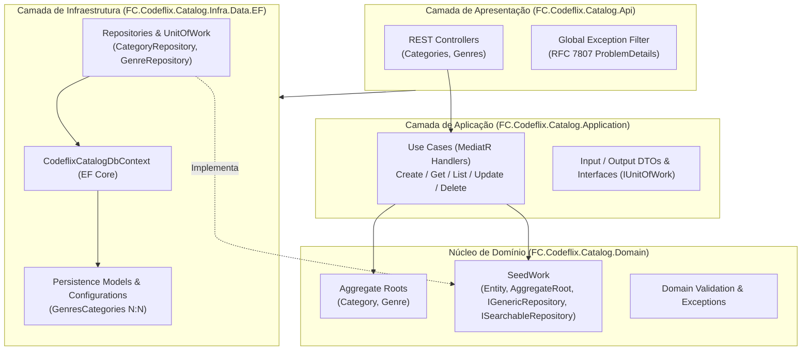

# 🎬 Codeflix Catalog Admin — Microsserviço de Catálogo de Vídeos (.NET)


API RESTful de administração do catálogo de vídeos da plataforma **Codeflix**, desenvolvida em **C# / .NET 10** aplicando **Clean Architecture**, **Domain-Driven Design (DDD)** e **Test-Driven Development (TDD)** com pirâmide completa de testes (Unitários, Integração e End-to-End).

---

## 🏛️ Visão Geral e Arquitetura

O projeto foi desenhado para isolar completamente as regras de negócio de detalhes de infraestrutura, frameworks web e banco de dados, seguindo os princípios da **Clean Architecture** combinados aos blocos táticos do **DDD**:



### Principais Decisões Arquiteturais

- **Entidades Ricas e Invariantes de Domínio (`Domain`)**:
  - Os agregados (`Category`, `Genre`) protegem seu próprio estado interno através de construtores/fábricas estáticas (`Create`), encapsulamento de coleções (`IReadOnlyList<Guid> Categories`) e métodos de comportamento (`Update`, `Activate`, `Deactivate`, `AddCategory`, `RemoveCategory`).
  - Nenhuma entidade persiste em estado inválido: validações de domínio disparam `EntityValidationException` imediatamente na criação ou mutação.
- **Limites de Agregado e Relacionamentos Desacoplados**:
  - Seguindo boas práticas de DDD, o agregado `Genre` referencia `Category` apenas por identidade (`Guid`), evitando grafos de objetos acoplados em memória.
  - Na camada de infraestrutura (`Infra.Data.EF`), o modelo de junção `GenresCategories` mapeia a relação N:N no banco relacional sem poluir a entidade de domínio com propriedades de navegação do Entity Framework.
- **Casos de Uso Orientados a Comandos/Queries (`Application`)**:
  - Cada operação de negócio (`CreateCategory`, `UpdateGenre`, `ListCategories`, etc.) é isolada em seu próprio caso de uso orquestrado via **MediatR**, respeitando o *Single Responsibility Principle (SRP)* e facilitando a evolução independente.
- **Padrão Repository & Unit of Work (`Infra.Data.EF`)**:
  - Os contratos de repositório (`ICategoryRepository`, `IGenreRepository`) residem no Domínio, enquanto a implementação com **EF Core** fica restrita à Infraestrutura.
  - O `UnitOfWork` coordena a atomicidade transacional (`Commit` / `Rollback`), garantindo que mutações em múltiplos DbSets (como `Genres` + `GenresCategories`) ocorram na mesma transação.
  - Consultas paginadas utilizam extensões reutilizáveis sobre `IQueryable` (`ApplyFilter`, `ApplyOrder`, `ToSearchOutputAsync`) com ordenação dinâmica segura e desempate determinístico por `Id`.
- **Padronização de Contratos HTTP e Tratamento Global de Erros (`Api`)**:
  - Serialização padronizada em `snake_case` e envelopes de resposta consistentes (`ApiResponse<T>` e `ApiResponseList<T>` com metadados de paginação).
  - Filtro global (`ApiGlobalExceptionFilter`) traduzindo exceções de domínio e aplicação (`EntityValidationException` $\rightarrow$ `422 Unprocessable Entity`, `RelatedAggregateException` $\rightarrow$ `422 Unprocessable Entity`, `NotFoundException` $\rightarrow$ `404 Not Found`) para o padrão **RFC 7807 (`ProblemDetails`)**.

---

## 🛠️ Tecnologias, Bibliotecas e Padrões

| Categoria | Tecnologia / Biblioteca | Finalidade |
| :--- | :--- | :--- |
| **Runtime & Web** | **.NET 10** / **ASP.NET Core Web API** | Plataforma base e exposição dos endpoints REST |
| **Mensageria Interna** | **MediatR 14** | Desacoplamento entre Controllers e Casos de Uso |
| **ORM & Banco de Dados** | **Entity Framework Core 9** + **Pomelo MySQL** | Persistência relacional, Migrations e mapeamento Fluent API |
| **Documentação da API** | **Microsoft.AspNetCore.OpenApi** + **Swagger UI** | Especificação OpenAPI `/openapi/v1.json` e interface interativa |
| **Testes Automatizados** | **xUnit**, **FluentAssertions**, **Moq**, **Bogus** | Testes de unidade, integração (EF InMemory) e E2E (`WebApplicationFactory` + MySQL) |
| **Qualidade & Padronização** | **CSharpier** + **Central Package Management** | Formatação automática de código e gestão centralizada de versões em `Directory.Packages.props` |
| **Containerização** | **Docker** & **Docker Compose** | Provisionamento dos bancos MySQL de desenvolvimento e testes E2E |

---

## 📂 Estrutura de Pastas

A solução (`FC.Codeflix.Catalog.sln`) é dividida entre código de produção (`src/`) e suítes de teste (`tests/`):

```text
├── src/
│   ├── FC.Codeflix.Catalog.Domain/          # Entidades (Category, Genre), Interfaces de Repositório, Exceções e SeedWork
│   ├── FC.Codeflix.Catalog.Application/     # Casos de Uso (Category, Genre), DTOs de Input/Output, IUnitOfWork e Exceções de Aplicação
│   ├── FC.Codeflix.Catalog.Infra.Data.EF/   # CodeflixCatalogDbContext, Mapeamentos Fluent API, Migrations, Repositories e UnitOfWork
│   └── FC.Codeflix.Catalog.Api/             # Controllers, Contratos Request/Response, Exception Filters, DI e Configurações
│
├── tests/
│   ├── FC.Codeflix.Catalog.UnitTests/        # Testes de unidade puros de Domínio e Aplicação (com Moq e Bogus)
│   ├── FC.Codeflix.Catalog.IntegrationTests/ # Testes de integração de Repositórios, UnitOfWork e Use Cases com EF Core InMemory
│   └── FC.Codeflix.Catalog.EndToEndTests/    # Testes ponta a ponta dos endpoints HTTP reais (WebApplicationFactory + MySQL)
│
├── Directory.Packages.props                  # Gerenciamento centralizado de pacotes NuGet (CPM)
└── .config/dotnet-tools.json                 # Manifesto de ferramentas locais (.NET Tools - CSharpier)
```

---

## 🚀 Como Executar

### Pré-requisitos

- [.NET 10 SDK](https://dotnet.microsoft.com/download)
- [Docker e Docker Compose](https://www.docker.com/)

### 1. Subir o Banco de Dados (MySQL via Docker)

Para desenvolvimento local (porta `3306`):

```bash
docker compose -f src/FC.Codeflix.Catalog.Api/docker-compose.yml up -d
```

### 2. Executar a API

As migrations do Entity Framework Core são aplicadas automaticamente na inicialização em ambiente `Development`:

```bash
dotnet run --project src/FC.Codeflix.Catalog.Api
```

- **Swagger UI**: acesse `http://localhost:5155/swagger` (ou a porta HTTPS configurada no perfil de inicialização).
- **OpenAPI Spec**: `http://localhost:5155/openapi/v1.json`

### 3. Executar os Testes Automatizados

Executar toda a suíte de testes:

```bash
dotnet test
```

Ou executar por camada da pirâmide de testes:

```bash
# Testes de Unidade (rápidos, sem dependências externas)
dotnet test tests/FC.Codeflix.Catalog.UnitTests

# Testes de Integração (Repositórios, UnitOfWork e Casos de Uso com EF Core InMemory)
dotnet test tests/FC.Codeflix.Catalog.IntegrationTests

# Testes End-to-End (requer o container MySQL de E2E na porta 33060)
docker compose -f tests/FC.Codeflix.Catalog.EndToEndTests/docker-compose.yml up -d
dotnet test tests/FC.Codeflix.Catalog.EndToEndTests
```

### 4. Formatação de Código (CSharpier)

```bash
dotnet tool restore
dotnet csharpier .
```

### 5. Gerenciamento de Migrations (EF Core CLI)

Para gerar uma nova migration no projeto `FC.Codeflix.Catalog.Infra.Data.EF` utilizando o ambiente `Migrations` (`appsettings.Migrations.json`):

```bash
dotnet ef migrations add <NomeDaMigration> --project src/FC.Codeflix.Catalog.Infra.Data.EF --startup-project src/FC.Codeflix.Catalog.Api --output-dir Migrations -- --environment Migrations
```

Para aplicar as migrations manualmente no banco de dados via CLI:

```bash
dotnet ef database update --project src/FC.Codeflix.Catalog.Infra.Data.EF --startup-project src/FC.Codeflix.Catalog.Api -- --environment Migrations
```

---

## 📡 Principais Endpoints da API

### Categorias (`/categories`)
| Método | Rota | Descrição | Status de Sucesso |
| :--- | :--- | :--- | :--- |
| `POST` | `/categories` | Cria uma nova categoria | `201 Created` |
| `GET` | `/categories/{id}` | Busca uma categoria pelo `Id` | `200 OK` |
| `GET` | `/categories` | Lista categorias com paginação, busca (`search`) e ordenação (`sort`, `dir`) | `200 OK` |
| `PUT` | `/categories/{id}` | Atualiza nome, descrição e status de uma categoria | `200 OK` |
| `DELETE` | `/categories/{id}` | Remove uma categoria | `204 No Content` |

### Gêneros (`/genres`)
| Método | Rota | Descrição | Status de Sucesso |
| :--- | :--- | :--- | :--- |
| `POST` | `/genres` | Cria um gênero e vincula categorias existentes (`categories_ids`) | `201 Created` |
| `GET` | `/genres/{id}` | Busca um gênero pelo `Id` com suas categorias associadas | `200 OK` |

